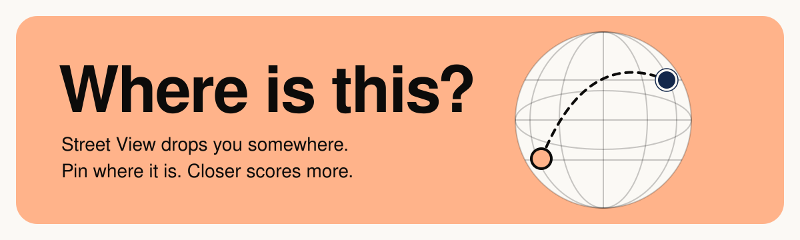
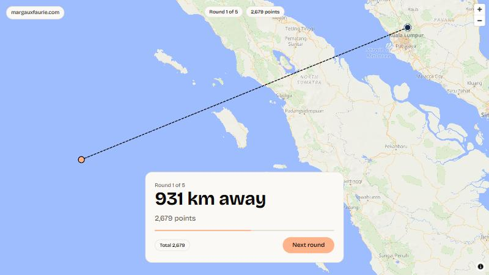
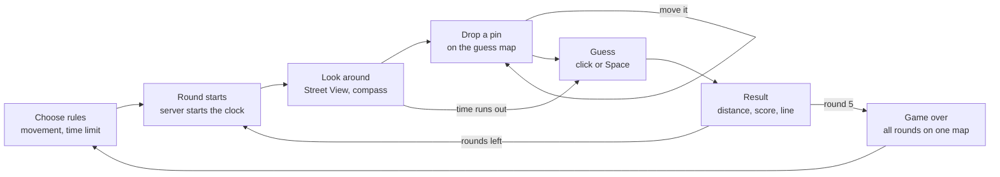
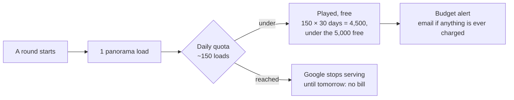
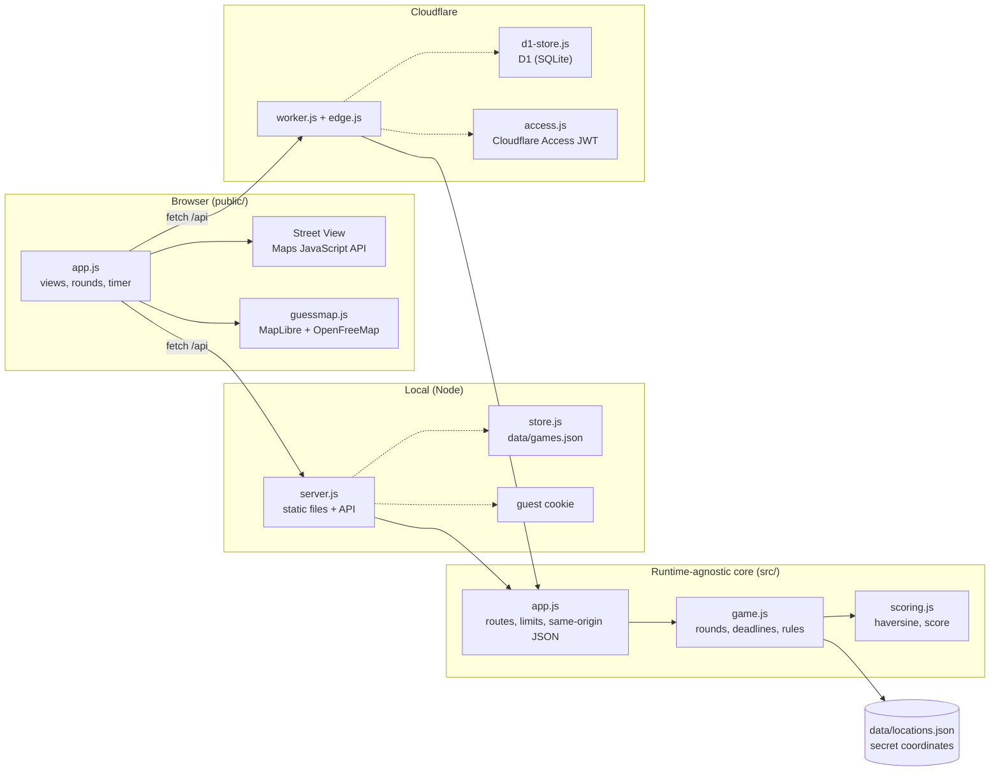
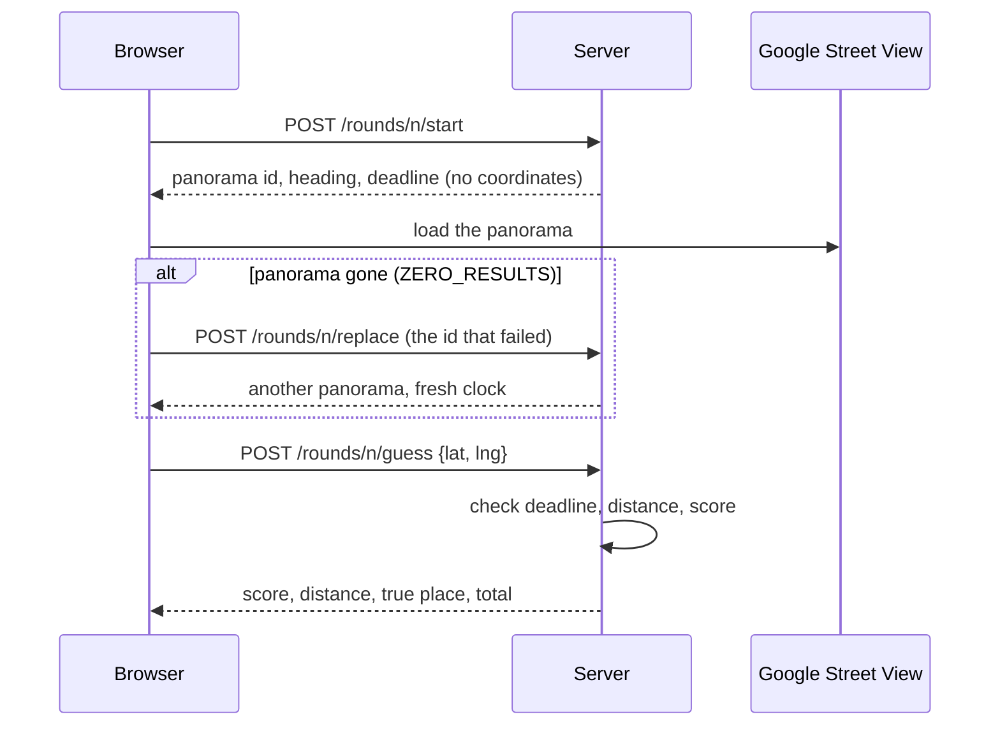
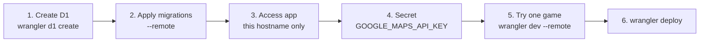

  

guessgeo is a GeoGuessr-style game for friends. Street View drops you somewhere in the world; you look around, drop a pin on the map where you think you are, and score up to 5,000 points depending on how close you got. Five rounds make a game. It will live at **guessgeo.margauxfaurie.com** and follows the Portfolio Design System.

The server owns the game: it picks the places, keeps their coordinates secret until you guess, runs the clock and computes every score. The browser only ever shows a panorama and sends a pin.

**Status:** plays end to end on a local server, tested in a browser on desktop and phone sizes. The Cloudflare version (Worker, D1, Access) is built and tested in Node but not deployed yet. No npm dependencies, no build step, Node 20 or newer.

  
   A round's result. Map © OpenFreeMap, OpenMapTiles, OpenStreetMap contributors.

## How a game works for you

1. **Choose the rules.** Move around freely, no moving, or no moving, panning or zooming; and a time limit per round, or none.
2. **Look around.** A Street View panorama fills the screen. A compass shows where north is, and *Back to start* returns you to where you landed.
3. **Pin it.** The map in the corner grows when you point at it. Click (or press <kbd>Enter</kbd> on the focused map) to drop your pin, then *Guess* or <kbd>Space</kbd>.
4. **See how close you were.** The map fills the screen with your pin, the true place and the great-circle line between them, plus the distance and the score.
5. **Next round,** with the button or <kbd>Enter</kbd>. After five rounds, a map shows every guess and every answer.

## Fair-play promises

- **The answer never reaches your browser before you guess.** The server sends a panorama id and a starting heading, never coordinates. A round's panorama id is not even sent until the round starts.
- **The server keeps the time.** Your clock starts when you open the round, not while you read the previous result. A guess arriving more than 2 seconds after the limit scores 0.
- **One guess per round, in order.** Scores are computed once, on the server, in one place (`src/scoring.js`).
- **A dead panorama is not your fault.** If Google has removed a place since the list was built, the round gets another place for free, once, with a fresh clock. The old place is never revealed.
- **Nobody can read your game.** A game belongs to your player id; any other id gets the same "not found" as a game that does not exist.

The score for a miss of `d` km is `round(5000 × e^(−10·d / D))`, where `D` is the map's size (14,917 km for the World map). Within 25 m is a perfect 5,000; about 1,000 km away is worth about 2,500.

## What it costs

Short answer: **nothing**, for a group of friends. Google gives a free allowance every month for each kind of call, and the game stays under it on purpose. Prices checked on 28 Nov 2026 on [Google's pricing page](https://developers.google.com/maps/billing/pricing).

| What the game uses | Google SKU | Free each month | After that | How often guessgeo uses it |
|---|---|---|---|---|
| The panorama you look around in | Dynamic Street View | 5,000 | $14 per 1,000 | About 1 per round, so 5 per game |
| Finding the 200 places (`npm run locations`) | Street View Metadata | Unlimited | Free | A few hundred lookups, once, offline |
| The guess map | none (OpenFreeMap, OpenStreetMap data) | Unlimited | Free | Every round, never billed by Google |
| Loading the Maps JavaScript library | none on its own | | | Only the Street View viewer is created, no Google map |

So the free 5,000 panoramas are about **1,000 games a month**, or 30 games a day.

**How it stays free, in three layers:**

1. **A daily quota** in Google Cloud (APIs & Services › Maps JavaScript API › Quotas) of about 150 panorama loads a day. A month of that is 4,500, under the 5,000 free, so even a busy month cannot be billed: on a heavy day Google stops showing panoramas instead of charging.
2. **A budget alert** on the billing account, so any charge at all sends an email.
3. **Limits in the game itself:** 30 new games an hour per player, 90 per address, and Cloudflare Access in front of the deployed game, so only invited friends can spend the quota.

The keys are locked down too: the browser key only works for the Maps JavaScript API and only from `localhost:3000` and `guessgeo.margauxfaurie.com`; the server key only works for Street View metadata and never reaches a browser.

**To check:** Google does not say exactly which Street View calls count (the first panorama, every change of panorama, or each move). The table assumes one per round. Watch the first days in Google Cloud › APIs & Services › Metrics, and lower the daily quota if a round turns out to count more than once.

## How the repo works

The game rules are plain JavaScript with no Node imports, so the same files run in the local Node server and in a Cloudflare Worker. Only the edges change: where games are stored and who the player is.

One round, from the moment you open it to the result:

| Path | What lives there |
|---|---|
| [`src/scoring.js`](src/scoring.js) | Haversine distance and the score formula. The only place scores are computed. |
| [`src/game.js`](src/game.js) | Game rules: picking places, round order, clocks, guesses, dead-panorama replacement. |
| [`src/app.js`](src/app.js) | The HTTP API: routes, rate limits, same-origin JSON checks, errors. Request in, Response out. |
| [`src/maps.js`](src/maps.js) | Validation of `data/locations.json`. |
| [`src/store.js`](src/store.js) | Memory and JSON-file stores for local play, with optimistic concurrency. |
| [`src/d1-store.js`](src/d1-store.js) | The same store contract on Cloudflare D1. |
| [`src/access.js`](src/access.js) | Cloudflare Access JWT verification (RS256, cached keys, fails closed). |
| [`src/edge.js`](src/edge.js), [`src/worker.js`](src/worker.js) | Wiring for the Cloudflare Worker. |
| [`src/server.js`](src/server.js) | Local dev server: static files, the API, security headers. |
| [`src/security-headers.js`](src/security-headers.js) | CSP and other headers, mirrored in [`public/_headers`](public/_headers) for Cloudflare. |
| [`public/app.js`](public/app.js) | The client: views, Street View, rounds, results, keyboard. |
| [`public/guessmap.js`](public/guessmap.js) | The guess map: MapLibre, markers, great-circle lines. |
| [`scripts/build-locations.mjs`](scripts/build-locations.mjs) | Builds `data/locations.json` from Google's free Street View metadata. |
| [`migrations/`](migrations) | D1 schema. |
| [`test/`](test) | Node test runner: rules, API over HTTP, stores, Access, hardening. |

## Run it locally

1. **Google Cloud:** create a project, link billing (a card is needed even inside the free monthly allowance; see [What it costs](#what-it-costs)), and enable the **Maps JavaScript API** and the **Street View Static API**.
2. **Two keys:**
   - a browser key, restricted to the Maps JavaScript API and to `http://localhost:3000/*` (plus the real domain later);
   - a server key, restricted to the Street View Static API, never sent to a browser.
3. **Safeguards:** a budget alert, and a daily quota of about 150 panorama loads so Google stops serving rather than billing (see [What it costs](#what-it-costs)).
4. `cp .env.example .env` and fill in both keys.
5. `npm run locations` finds 200 real panoramas around the world and writes `data/locations.json`.
6. `npm start`, then open http://localhost:3000.

`npm test` runs the test suite. It never calls Google. The D1 tests use Node's built-in SQLite and are skipped before Node 22.5. The dev server listens on 127.0.0.1 only (`HOST=0.0.0.0` to share it on your network).

## API

| Method and path | What it does |
|---|---|
| `GET /api/config` | The browser Maps key. |
| `GET /api/maps` | Available maps and how many places each has. |
| `POST /api/games` | New game with `{settings: {movement, time_limit_s, rounds}}`. |
| `GET /api/games/:id` | Your game: settings, current round (no coordinates), finished rounds. |
| `POST /api/games/:id/rounds/:n/start` | Starts round `n`'s clock and returns its panorama. Idempotent. |
| `POST /api/games/:id/rounds/:n/replace` | Swaps a dead panorama, once per round: `{failed_pano_id}`. |
| `POST /api/games/:id/rounds/:n/guess` | `{guess: {lat, lng}}`, or `{guess: null}` to skip. Returns the result. |

Errors are JSON: `{error, message}`. Status codes: 400 bad input, 404 not yours or missing, 409 out of order or changed elsewhere, 410 too late (the body still carries the result), 429 too many requests.

## Security

- **Server-authoritative:** coordinates leave `game.js` only through `reveal`, after a round is resolved.
- **Requests:** POSTs must be same-origin `application/json`, at most 10,000 bytes; ids in paths must be UUIDs.
- **Limits:** 30 new games an hour per player and 90 per client address, one guess a second per game.
- **Identity:** locally, a random id in an `HttpOnly`, `SameSite=Lax` cookie (`__Host-` and `Secure` over HTTPS). On Cloudflare, a verified Access token for one application audience; nothing else is trusted.
- **Headers:** `X-Content-Type-Options`, `X-Frame-Options: DENY`, `Referrer-Policy`, `Permissions-Policy`, and a Content Security Policy that lists every host the page uses. The CSP is report-only until the console is clean with the live Google scripts; then rename it to `Content-Security-Policy`.
- **Third-party code:** MapLibre is pinned (5.24.1) and loaded with a Subresource Integrity hash, so a changed file is refused. To upgrade, change the version in `public/index.html` and recompute both hashes.
- **Secrets:** keys live in `.env` locally and in Wrangler secrets on Cloudflare. `data/locations.json` holds the answers: it is gitignored and never served from `public/`.

## Maps and terms

The guess map is [MapLibre GL](https://maplibre.org) on [OpenFreeMap](https://openfreemap.org) tiles (OpenStreetMap data): free, no key, no account. Each player's browser asks OpenFreeMap for tiles directly.

The Google billing account is in France, so the Google Maps Platform EEA terms apply. They allow Google content next to a third-party map at your own discretion (the global terms forbid Street View and a non-Google map on one screen). One clause is still open: the EEA terms say Street View Static API content may not be used with any map, and `npm run locations` takes the true coordinates from the Street View Static metadata endpoint. The panorama in the game itself comes from the Maps JavaScript API. This is a reading of the terms, not legal advice.

## Deploying to Cloudflare (guessgeo.margauxfaurie.com)

The API runs as a Worker, games live in D1, players are identified by Cloudflare Access. `data/locations.json` is bundled at deploy time and stays out of git, so deploy from the machine that generated it.

1. `npx wrangler@4 d1 create guessgeo`, then put the returned id in `wrangler.toml`.
2. `npx wrangler@4 d1 migrations apply guessgeo --remote`.
3. In Zero Trust › Access › Applications, create an application for `guessgeo.margauxfaurie.com` only (not a wildcard: its audience tag would accept a token issued for any other subdomain), allow your friends, then fill `ACCESS_TEAM_DOMAIN` and `ACCESS_AUD` in `wrangler.toml`. Without them the API refuses every request.
4. `npx wrangler@4 secret put GOOGLE_MAPS_API_KEY` (the browser key; add `https://guessgeo.margauxfaurie.com/*` to its allowed sites).
5. Play one round with `npx wrangler@4 dev --remote`: the D1 store has been tested against Node's SQLite, not yet against Cloudflare's own result format.
6. `npx wrangler@4 deploy`. `wrangler.toml` declares the custom domain and turns off the public workers.dev and preview addresses.

## Tested and not yet tested

**Tested in a browser (27–28 Nov 2026):** full games on the local server; all three movement modes; the timer running out; compass and *Back to start*; mouse and keyboard play; resume after a reload; result and game-over maps; a phone-size screen.

**Not tested yet:** the replacement of a dead panorama in a browser (it needs a real dead one; the server side is tested), the Worker on Cloudflare, and real Google billing (watch the first day's usage).

## Known limits and next steps

- Anyone with dev tools open can read a panorama's position from the Street View objects. The server keeps the answer and the score honest, not the panorama. Fine for friends.
- The 200 locations can be learned by skipping rounds, since answers are revealed. Before public leaderboards: a much larger pool, and no place a player has already seen.
- Local games live in one JSON file, rewritten on each change. Fine for a few players.
- Abandoned games are never deleted yet; add a retention rule in D1 before opening the game beyond friends.
- Rate limits on Cloudflare are per Worker instance, so approximate; Access and the per-address limit protect the Google quota.
- Next: deploy, challenge links for friends, daily challenge, leaderboards. Design notes are in [`docs/design-notes.md`](docs/design-notes.md).
